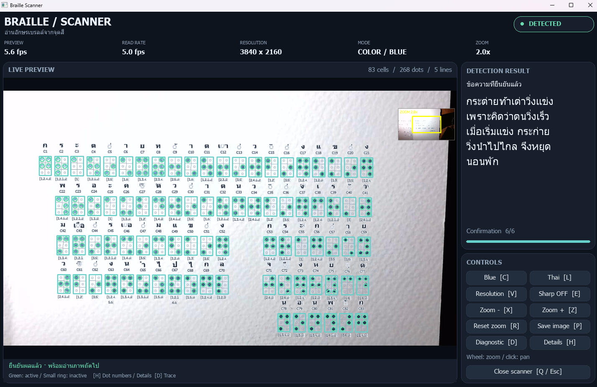
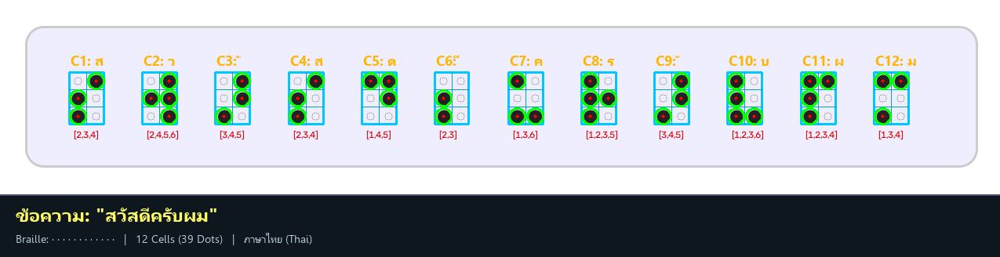
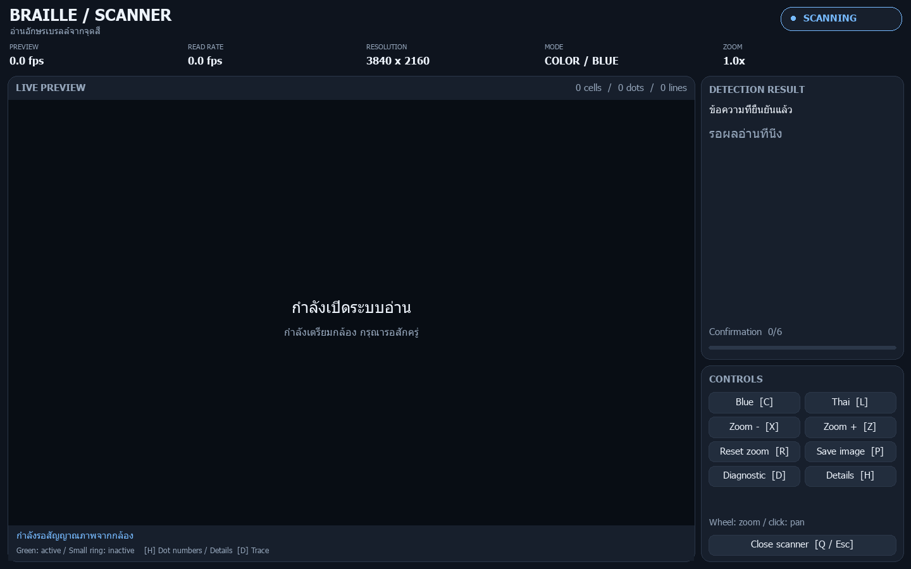

# Braille-to-Speech Scanner

ระบบอ่านอักษรเบรลล์ภาษาไทย/อังกฤษจากกล้อง แล้วแปลงเป็นข้อความและเสียงพูด
ช่วยให้คนตาดีที่อ่านเบรลล์ไม่เป็น (ครู ผู้ปกครอง เจ้าหน้าที่) ตรวจหรือฟังเนื้อหาเบรลล์ได้ทันที



## แนวทางของโปรเจกต์

จุดเบรลล์นูนบนกระดาษขาวมีคอนทราสต์ต่ำมาก กล้องทั่วไปแยกจุดได้ไม่แม่นเมื่อแสงเปลี่ยน
โปรเจกต์นี้จึงใช้ **จุดที่แต้มสี (น้ำเงิน/แดง)** เป็นสัญญาณหลัก: ตรวจด้วยสีแทนเงา ทำให้เสถียรกว่าและอธิบายได้ง่าย

```
กล้อง (สูงสุด 4K)
  → ตรวจจุดสี (HSV) + กรอง noise
  → จัดกริดเซลล์ 2×3 และหาตำแหน่งจุด 1–6
  → ติดตามกริดข้ามเฟรม (optical flow) + ยืนยันผลหลายเฟรม
  → ถอดรหัสเบรลล์ไทย/อังกฤษ (parser + lexicon)
  → แสดงข้อความ + อ่านออกเสียง (Piper offline / Edge TTS online)
```

| ขั้น | ภาพตัวอย่าง |
|---|---|
| ถอดรหัสเซลล์ → ข้อความไทย ("สวัสดีครับผม") |  |
| หน้าจอสแกนเนอร์ (Live preview, ผลยืนยัน, ปุ่มควบคุม) |  |

## ฟีเจอร์หลัก

- อ่านเบรลล์ไทยตามมาตรฐาน รวมสระ วรรณยุกต์ และเครื่องหมาย; รองรับอังกฤษ Grade 1
- เลือกความละเอียดกล้องอัตโนมัติ (4K / 2K / 1080p), zoom/pan, กำหนดพื้นที่อ่านคงที่สำหรับกล้องบนขาตั้ง
- ยืนยันข้อความเมื่อผลนิ่งหลายเฟรม ลดการอ่านผิดจากมือหรือกล้องสั่น
- เสียงพูดภาษาไทยแบบ offline (Piper) และ online (Edge TTS) พร้อมจังหวะเว้นวรรค
- โมเดล YOLO (ทางเลือก) สำหรับเสนอกรอบบริเวณข้อความ ฝึกด้วย dataset สังเคราะห์ 3,000 ภาพ
- เครื่องมือสร้างหนังสือเบรลล์ใน Word พร้อมจุดนำเจาะ สำหรับทำสื่อทดสอบ

## เทคโนโลยี

Python 3.12 · OpenCV · NumPy · Ultralytics YOLOv8 · Piper TTS · Edge TTS · python-docx

## เริ่มใช้งาน

```powershell
py -3.12 -m venv .venv
.\.venv\Scripts\python.exe -m pip install -r requirements.txt
.\main.bat
```

`main.bat` เปิดเมนู: สแกนจากกล้อง, สแกนพร้อมเสียง, ทดสอบภาพเดี่ยว

## เอกสารเพิ่มเติม

- [คู่มือใช้งานและรายละเอียดทางเทคนิค](docs/USAGE_TH.md)
- [อัลกอริทึมตัวอ่านเฉพาะสี](docs/COLORED_BRAILLE_ONLY_TH.md)
- [หน้าจอสแกนเนอร์](docs/SCANNER_UI_TH.md)
- [Dataset สังเคราะห์และการฝึก YOLO](docs/SYNTHETIC_DATASET.md)
- [เสียงพูด Piper offline](docs/PIPER_OFFLINE_TTS_TH.md)

## ข้อจำกัด

- อ่านเฉพาะจุดที่แต้มสีน้ำเงินหรือแดง จุดนูนที่ไม่มีสียังไม่รองรับ
- ทดสอบบน Windows เป็นหลัก
