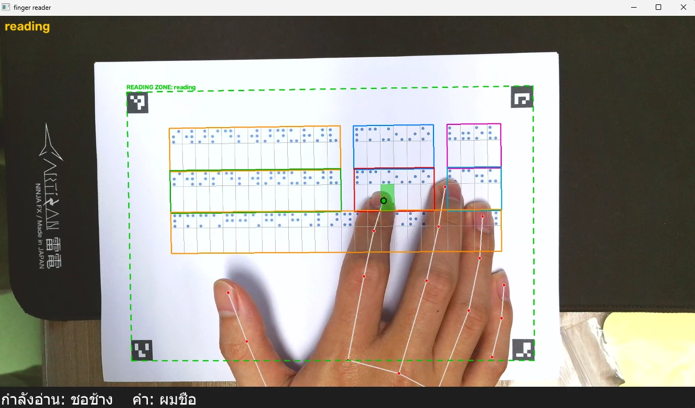
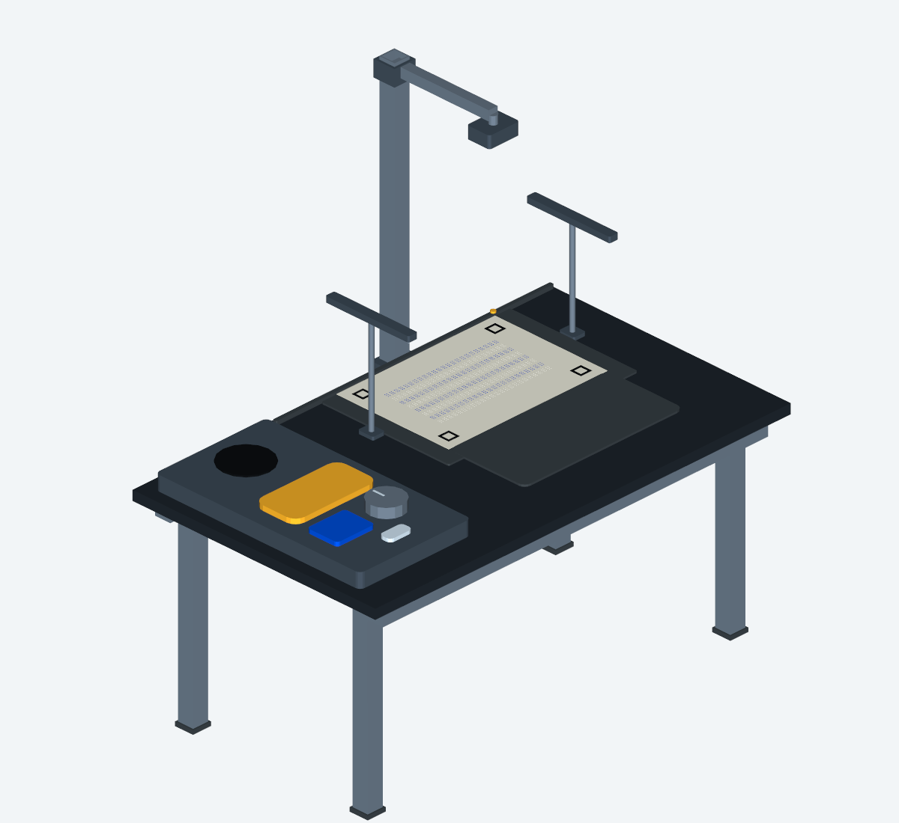
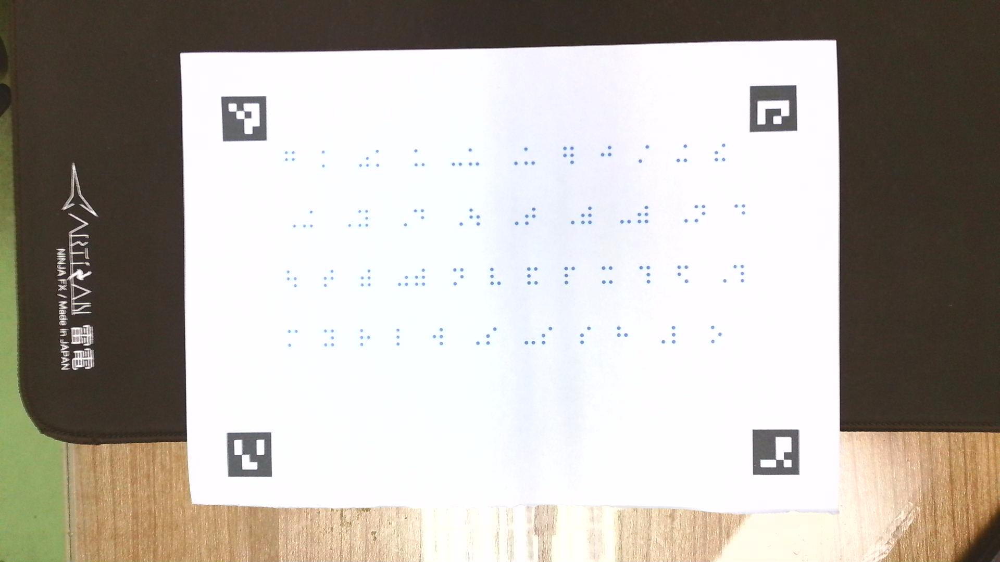
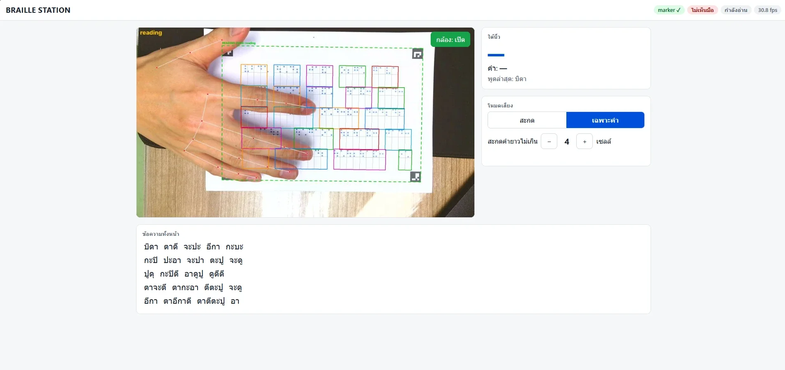

# Braille Finger Reader

สถานีฝึกอ่านอักษรเบรลล์ภาษาไทยด้วยนิ้ว: ผู้เรียนลากนิ้วบนบรรทัดเบรลล์นูน
แล้วระบบพูดชื่อตัวอักษรใต้ปลายนิ้วทันที และพูดทั้งคำเมื่อนิ้วอ่านจบคำ



*ภาพจากกล้องจริงขณะอ่าน: เส้นขาวและจุดแดงคือโครงมือจาก MediaPipe วงกลมดำคือจุดอ่านบนนิ้วชี้
กรอบแต่ละสีคือหนึ่งคำ เซลล์สีเขียวคือเซลล์ที่นิ้วแตะอยู่ เส้นประเขียวคือพื้นที่อ่านจาก marker
แถบล่างแสดงชื่อตัวอักษรใต้นิ้วและคำที่นิ้วอยู่*

## หลักการ

หนังสือแต่ละหน้ามี **2 บรรทัดคู่กัน**: บรรทัดจุดสีน้ำเงินที่พิมพ์ไว้ให้กล้องอ่าน
และบรรทัดนูนที่เขียนด้วยสเลทไว้ให้นิ้วสัมผัสอยู่ใต้บรรทัดสีพอดี
กล้องอ่านบรรทัดสี ส่วน MediaPipe ตามตำแหน่งนิ้ว ระบบจึงรู้ว่านิ้วอยู่บนเซลล์ไหน

```
กล้อง 1080p (สูง 270 มม. มองลงตรง)
  → ArUco marker 4 มุม: แปลงพิกัดภาพเป็นมิลลิเมตรบนหน้า
  → จุดสีน้ำเงิน (HSV + Otsu): จัดบรรทัด เซลล์ คำ แล้วถอดเป็นภาษาไทย
  → จำหน้า (อ่านตรงกัน 3 ครั้ง) และเตรียมเสียงทั้งหน้าไว้ล่วงหน้า
  → MediaPipe Hand Landmarker: ตามปลายนิ้วชี้
  → นิ้วเข้าเซลล์ใหม่: พูดชื่อตัวอักษร · นิ้วออกจากคำ: พูดทั้งคำ
```

- เสียงเล่นจากไฟล์ที่เตรียมไว้: เริ่มพูดประมาณ 0.2 วินาทีหลังนิ้วแตะเซลล์
- เสียง Edge TTS (ชัดกว่า) เมื่อมีอินเทอร์เน็ต และใช้ Piper แทนเมื่อออฟไลน์ ทุกเสียงเก็บไว้ในแคช
- กระดาษเลื่อนระหว่างอ่านได้ ระบบตามหน้าเดิมต่อ พลิกหน้าใหม่ ระบบจำหน้าใหม่เอง
- ผลทดสอบจริงที่กล้องสูง 270 มม.: อ่านเซลล์ถูก 59/60

### ทำไมใช้ MediaPipe

- ได้ตำแหน่งข้อนิ้ว 21 จุดต่อมือจากภาพ RGB ธรรมดา ไม่ต้องฝึกโมเดลเองหรือติดเซนเซอร์ที่นิ้ว
- ใช้ปลายนิ้วชี้ (landmark 8) ขยับเข้าหาข้อนิ้วเล็กน้อย (`--pad-fraction`) ให้ตรงกับส่วนของนิ้วที่สัมผัสจุดจริง
- ล็อกนิ้วที่กำลังอ่านไว้แม้มีสองมือในภาพ และคงล็อกไว้เมื่อตรวจไม่เจอชั่วครู่ (เช่น นิ้วบังกันเอง)
- แปลงตำแหน่งนิ้วเป็นมิลลิเมตรบนหน้าด้วย homography จาก marker แล้ว state machine ตัดสินว่านิ้วเข้าเซลล์ใหม่ อยู่ระหว่างคำ หรือยกนิ้ว

### สถานีอ่าน



แบบร่างสถานีสำหรับใช้งานจริง (ยังไม่ได้ประกอบ): กล้องติดแขนมองลงตรงที่ความสูง 270 มม. เหนือที่วางหนังสือ

## ทำหนังสือ



| ค่า | ตั้งเป็น |
|---|---|
| กระดาษ | A4 แนวตั้ง ตัดครึ่งเป็น A5 แนวนอน 2 หน้า |
| marker | ArUco 4×4 ขนาด 10 มม. ห่างขอบ 10 มม. ทั้ง 4 มุม |
| บรรทัดสี | SOV_braille_only 32.5 pt · Expanded 0.05 pt · Lowered 3 pt · สี #0050DC |
| ระยะบรรทัด | Exactly 10 มม. ตามสเลท · บรรทัดสีสลับกับแถวว่างสำหรับบรรทัดนูน |
| จำนวน | 4 คู่บรรทัดต่อหน้า · ไม่เกิน 24 เซลล์ต่อบรรทัด |

ที่ 32.5 pt ระยะเซลล์ของฟอนต์เท่ากับช่องสเลท (6.21 มม.) จึงไม่ต้องปรับระยะตัวอักษร 2 เซลล์หรือสระทีละตัว

```powershell
.\.venv\Scripts\python.exe tools\make_book_template.py --out output\book_template.docx
```

เปิดไฟล์ที่ได้ใน Word แล้วพิมพ์ข้อความลงบรรทัดสี พิมพ์ด้วยขนาดจริง (Normal-size / No Scaling)
แล้วเขียนบรรทัดนูนด้วยสเลทในแถวว่างใต้แต่ละบรรทัดสี

## เริ่มใช้งาน

```powershell
py -3.12 -m venv .venv
.\.venv\Scripts\python.exe -m pip install -r requirements.txt
.\.venv\Scripts\python.exe finger_reader.py `
    --tts-thai-model scratch\piper-voices\th_TH-tsync2-medium.onnx `
    --tts-python scratch\piper-env\Scripts\python.exe `
    --symbol-voice edge --word-voice edge `
    --edge-python scratch\edge-tts-env\Scripts\python.exe
```

ต้องเตรียมเพิ่มเอง (ไม่อยู่ใน git):

- Python environment ของ Piper พร้อมเสียง `th_TH-tsync2-medium.onnx` ([requirements-piper.txt](requirements-piper.txt))
- Python environment ของ Edge TTS ([requirements-edge-tts.txt](requirements-edge-tts.txt))
- `models/hand_landmarker.task` ของ MediaPipe: ดาวน์โหลดจาก
  https://storage.googleapis.com/mediapipe-models/hand_landmarker/hand_landmarker/float16/1/hand_landmarker.task
  แล้ววางไว้ในโฟลเดอร์ `models/`

ตัวเลือกที่ใช้บ่อย: `--marker-size-mm` (ถ้า marker ไม่ใช่ 10 มม.), `--pad-fraction` (ตำแหน่งจุดอ่านบนนิ้ว),
`--headless` (ไม่เปิดหน้าจอ), `--debug-dir` (เก็บภาพเมื่อสถานะเปลี่ยน), `--log-latency` (บันทึกเวลาตอบสนอง)

### เปิดด้วยดับเบิลคลิก

เตรียมไฟล์ด้านบนให้ครบ แล้วดับเบิลคลิก `Start_Finger_Reader.bat` โปรแกรมเปิดพร้อมหน้าเว็บครูที่ http://localhost:8080
ถ้าขาดไฟล์ จะบอกชื่อไฟล์ที่ขาดแล้วหยุดรอ ส่งตัวเลือกเพิ่มต่อท้ายได้ เช่น `Start_Finger_Reader.bat --speech-mode word --web-fps 15`
ทำไอคอนบนเดสก์ท็อป: คลิกขวาที่ไฟล์ → Send to → Desktop (create shortcut)

### โหมดเสียง

| โหมด | พูดอะไร |
|---|---|
| `spell` (ค่าเริ่มต้น) | ชื่อตัวอักษรทุกเซลล์ แล้วพูดคำเมื่ออ่านจบคำ |
| `word` | เฉพาะคำเมื่ออ่านจบคำ ยกเว้นคำยาวไม่เกิน `--spell-max-cells` (ค่าเริ่มต้น 2) ที่ยังสะกด |

คำจะถูกพูดเฉพาะเมื่อนิ้วผ่านครบทุกเซลล์ ยกนิ้วหรือย้ายบรรทัดกลางคำจะไม่พูดคำ
เปลี่ยนบรรทัดต้องค้างนิ้วบนบรรทัดใหม่ 0.4 วินาที มือที่เฉียดบรรทัดอื่นจึงไม่ทำให้พูด
ตั้งจาก CLI (`--speech-mode`, `--spell-max-cells`) หรือหน้าเว็บครู ค่าบันทึกใน `output/panel_settings.json`

### หน้าเว็บครู



เพิ่ม `--web 8080` (ไฟล์ .bat ใส่ให้แล้ว) แล้วเปิด http://localhost:8080 จากเครื่องเดียวกัน
หรือ `http://<IP เครื่อง>:8080` จากมือถือใน WiFi เดียวกัน (ดู IP ด้วย `ipconfig`; Windows Firewall ต้องอนุญาต Python ใน Private network)

- ดูภาพกล้องสด ตัวอักษรใต้นิ้ว คำที่กำลังอ่าน และข้อความทั้งหน้า
- เปลี่ยนโหมดเสียงและจำนวนเซลล์ได้ทันที เปิด/ปิดภาพกล้องเพื่อลดภาระ CPU
- `--web-fps N` (1–30, ค่าเริ่มต้น 5): ภาพลื่นขึ้นแต่กิน CPU มากขึ้น บนบอร์ดเล็กให้ใช้ค่าต่ำ
- ไม่มีรหัสผ่าน: ทุกเครื่องใน WiFi เดียวกันเปิดและเปลี่ยนค่าได้
- ดูหน้าเว็บโดยไม่ต่อกล้อง: `.\.venv\Scripts\python.exe -m http.server 8765 --directory web` แล้วเปิด http://localhost:8765/?demo
- API สำหรับพัฒนาต่อ: [docs/web-api.md](docs/web-api.md)

## โครงสร้าง

| ไฟล์ | หน้าที่ |
|---|---|
| `finger_reader.py` | โปรแกรมหลัก: ลำดับสถานะ เสียง และหน้าจอ dev |
| `page_calibration.py` | รูปแบบหน้าและ marker ArUco |
| `page_map.py`, `colored_braille.py` | อ่านจุดสีเป็นบรรทัด เซลล์ และคำ |
| `fingertip.py`, `finger_state.py` | ตามนิ้ว และตัดสินว่าเข้าเซลล์หรือจบคำ |
| `web_panel.py`, `web/index.html`, `panel_settings.py` | หน้าเว็บครู web server และค่าตั้งโหมดเสียง |
| `speech_queue.py`, `thai_speech.py` | เลือกข้อความที่จะพูด และคำสะกดสำหรับเสียงแต่ละแบบ |
| `decoder.py`, `thai_parser.py` | ถอดรหัสเบรลล์ไทย |
| `tools/make_book_template.py` | สร้างไฟล์ Word ต้นแบบพร้อม marker |
| `tools/diagnostics/symbol_speech_page.py` | หน้าฟังเสียงชื่อสัญลักษณ์ทั้งหมดเทียบ Piper กับ Edge |
| `tools/diagnostics/page_map_accuracy.py` | วัดความแม่นการอ่านจากภาพถ่ายเทียบข้อความเฉลย |
| `archive/legacy_scanner/` | ระบบสแกนรุ่นก่อน (ถือกล้องสแกน + YOLO) เก็บไว้อ้างอิง |

## ทดสอบ

```powershell
.\.venv\Scripts\python.exe -m unittest discover -s tests
```

## เทคโนโลยี

Python 3.12 · OpenCV (ArUco, HSV) · MediaPipe Hand Landmarker · Edge TTS · Piper TTS · python-docx

## ข้อจำกัด

- อ่านได้เฉพาะหนังสือที่ทำตามรูปแบบข้างบน (มีบรรทัดสีและ marker)
- ยังทดสอบบน Windows เท่านั้น: เล่นเสียงด้วย `winsound`
- ยังไม่ได้ทดสอบกับผู้เรียนจริงและหนังสือหลายหน้า
- Edge TTS เป็นบริการออนไลน์ที่ไม่เป็นทางการ คำใหม่ต้องใช้อินเทอร์เน็ตครั้งแรก
